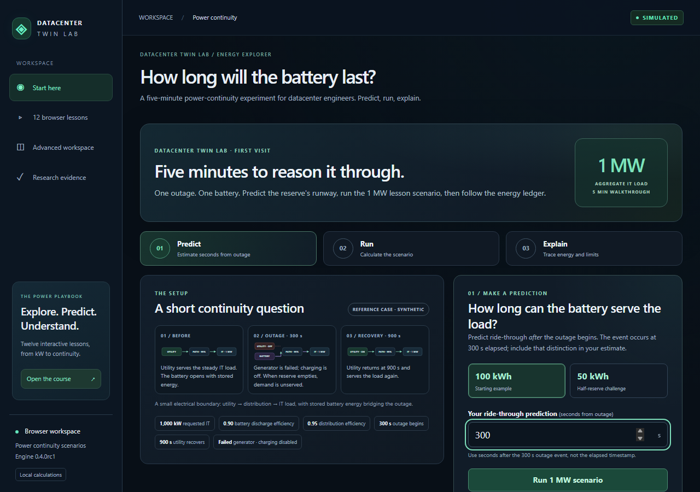
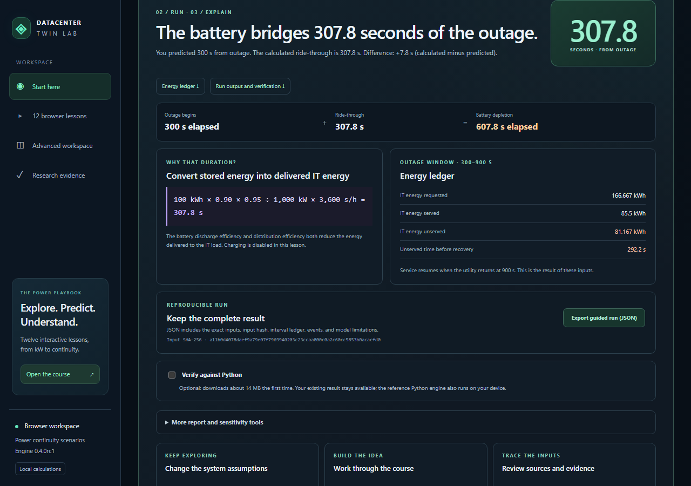

The native lab models outages, source paths, finite reserve, and exact energy accounting alongside infrastructure lessons. This companion isolates an illustrative IT-load and cooling-power relationship.

**[Native-source lesson guide](docs/portfolio/) · [Offline interactive lab](docs/index.html) · [Lesson configuration](docs/lesson-config.json) · [Configuration schema](docs/lesson-config.schema.json)**

## Previous animations

[Open the previous-animation gallery](https://mohammadrezwankhan.github.io/datacenter-twin-lab/animations/) · [Local gallery](docs/animations/index.html)

Earlier animated artwork, waveform demos, and original interactive experiences are linked alongside the current animations.

## Your first interactive result

1. Download or clone this repository and open `docs/index.html` in a modern browser.
2. Select **Module 1**, apply its preset, and compare the declared checkpoint with the plotted result.
3. Change one slider, inspect the model assumptions, then export the configuration or telemetry for your notes.

The browser lab runs offline with no packages, accounts, or live data feeds. Its numbers are deterministic teaching simulations. Each checkpoint states its model time and tolerance; passing it demonstrates agreement with that model, not field calibration or production readiness.

<!-- source-mapped-visuals:start -->

<details>
<summary>System topology and model boundaries</summary>


Conceptual supply topology; no source-specific reliability calculation.

Motion is optional; the vector topology remains readable with reduced motion enabled.

</details>

<!-- source-mapped-visuals:end -->

## Four-module learning path

| Module | Investigation | Approximate time |
|---|---|---:|
| 1. Build an electrical load ledger | Distinguish IT power from facility overhead and from stored energy. | 12 min |
| 2. Scale the population while holding efficiency | Identify which outputs scale with server count and which are ratios. | 15 min |
| 3. Stress an ambient and efficiency assumption | Quantify a cooling-power sensitivity without inventing a reliability result. | 15 min |
| 4. Connect the screen to continuity evidence | Prepare a bounded infrastructure comparison and choose the native follow-up study. | 18 min |

**Who this is for:** Datacenter engineers, infrastructure students, and researchers examining electrical continuity assumptions.

### Continue into the implementation

- [README.md](README.md)
- [pyproject.toml](pyproject.toml)
- [datacenter_twin/continuity.py](datacenter_twin/continuity.py)
- [docs/canonical-case.md](docs/canonical-case.md)
- [docs/quickstart.md](docs/quickstart.md)
- [apps/web/package.json](apps/web/package.json)
- [apps/web/src/curriculum.ts](apps/web/src/curriculum.ts)

### Explore or run the source

Python 3.12+ for the dependency-free native core; the existing React/Vite workspace has its own lockfile and optional API/study dependencies.

```bash
python -m pip install .
python -m datacenter_twin simulate --preset generator_failure
python -m unittest discover -s tests -v
```

These commands come from the audited source revision. Runtime requirements and the project's own validation limits are documented below; the standalone browser lab does not execute these commands.

The detailed project guide below remains the source for installation, supported features, licences, and scientific limits. The browser equations and laboratory settings do not change the original application or numerical engine.

<details>
<summary>Project documentation, installation, attribution, and existing validation</summary>

# Datacenter Twin Lab

_A reproducible synthetic continuity laboratory for datacenter power systems._

## Start with one battery question

[Read the 24 course lessons](https://khanlab.co.technology/learn/) · [Reference results and sources](https://khanlab.co.technology/evidence/) · [About the author](https://khanlab.co.technology/about/)

**How long can a 1 MW IT load ride through a utility outage on 100 kWh of stored battery energy?**

In the five-minute walkthrough, predict the battery's ride-through, deliberately run the scenario, then explain the result from its energy ledger. The example uses `100 kWh × 0.90` battery-discharge efficiency `× 0.95` distribution efficiency = **85.5 kWh delivered to IT**. At **1,000 kW**, that is **307.8 seconds from the outage**, which starts at **300 s elapsed**. Battery depletion is therefore recorded at **607.8 s elapsed**. Charging is disabled and the generator is failed.

[**Open the five-minute guided experiment →**](https://khanlab.co.technology/) · [Challenge yourself with 50 kWh](https://khanlab.co.technology/) · [Read the exact inputs and equations](docs/canonical-case.md)

Halving the opening reserve to **50 kWh** gives **42.75 kWh** delivered to IT: **153.9 s from the outage** and depletion at **453.9 s elapsed**. Ride-through is a duration counted from the 300 s outage boundary; depletion is an elapsed event timestamp.

> This is a teaching and research tool for datacenter engineers learning electrical continuity. It is a narrow, synthetic, uncalibrated model—not a production reliability analysis. Detailed model boundaries and validation status are below.

[](https://github.com/mohammadrezwankhan/datacenter-twin-lab/releases/tag/v2.0.1) [](https://github.com/mohammadrezwankhan/datacenter-twin-lab/actions/workflows/tests.yml) [](https://ko-fi.com/N7V826XG89)

**v2.0.0 — Infrastructure Engineering** adds twelve manuscript-derived lessons, 36 assessments, separate educational models and twelve original SVG scenes to the existing guide, twelve continuity lessons, eighteen presets, reports, EMT and five dynamics studies. [Publication decision and attribution](docs/releases/v2.0.0-publication-decision.md); engineering HOLD remains. The CI badge follows `main`; check the exact released commit's results before relying on them. See [release readiness](docs/engineering/release-readiness.md).

## The three steps

The pictures below are screenshots of the actual guided interface. Their numbered captions name the corresponding action in the walkthrough.

[](docs/images/guide-predict.png)

**01 · Predict.** Choose the 100 kWh starting example or 50 kWh challenge. Enter seconds from the outage at 300 s—not an elapsed timestamp. No result is shown until you choose **Run 1 MW scenario**.

[](docs/images/guide-result.png)

**02 · Run.** The result reports ride-through separately from depletion time, shows the equation, and breaks out requested, served, and unserved IT energy during the outage window.

[](docs/images/guide-evidence.png)

**03 · Explain.** Export the complete JSON run, inspect its inputs and hash, or optionally request a Python comparison. Report and reserve-sensitivity tools are available after the completed result.

[Watch the captioned 60-second tour in the evidence hub →](https://khanlab.co.technology/?mode=evidence#demo) · [Tour transcript and reproduction notes](docs/examples/proof-demo.md)

## Continue with another part of the lab

- [Open the advanced energy workspace](https://khanlab.co.technology/?mode=advanced) to inspect the full topology, replay events, change bounded assumptions, and export runs.
- [Open the existing 50 MW outage case](https://khanlab.co.technology/?preset=ai_cluster_utility_loss). It is a synthetic aggregate electrical case, not a GPU-throughput or grid-adequacy model.
- [Start the 24-lesson course](https://khanlab.co.technology/?lesson=power-energy), or read its [course notes](docs/tutorials/power-systems-course.md).
- Visit the [evidence hub](https://khanlab.co.technology/?mode=evidence) for source records and reproducibility material.
- Browse the [tutorials](docs/tutorials/index.md), [scenario catalog](docs/scenarios/index.md), [unit-aware glossary](docs/scenarios/glossary.md), and [contribution ideas](docs/scenarios/contribution-ideas.md).

The current source includes 18 named scenarios, four illustrative facility profiles, 24 lessons, and on-demand reports and sensitivity tools. Ratings, demand, event timing, rates, and efficiencies are explicit synthetic inputs. [The roadmap](ROADMAP.md) separates capabilities in the release from work still planned or conditional.

## Explore faster electrical dynamics

Go beyond the outage timeline with the [DC-link EMT lesson](https://khanlab.co.technology/?mode=emt): configure an ideal RLC circuit, replay its voltage sag, inspect signed current and compare JavaScript with Python.

The [power-dynamics studio](https://khanlab.co.technology/?study=load-step) adds five configurable Python studies: converter load steps, oscillation modes, a synthetic load spectrum, phase-model versus QSS response, and a modified nine-bus network. Color-coded diagrams, plots and JSON/CSV exports connect every result to its applied inputs. Its scientific runtime loads only when requested.

[Read the EMT equations](docs/studies/emt.md) · [Study catalog and reproduction commands](docs/studies/power-dynamics.md). These additions are available on the current website and source; historical v1.0.0 assets remain unchanged.

## Reproduce the canonical case

The guide follows lesson 3's exact scenario recipe: it starts from the reference-site inputs, then assigns lesson ID/name and source metadata, disables charging, and sets the initial reserve to `100` or `50` kWh. The [canonical case](docs/canonical-case.md) records those inputs and derives the results independently. A direct `generator_failure` preset run happens to produce the same 100 kWh numeric event time because the battery starts full, but its scenario ID, metadata, charging limit, input hash, and run ID are different.

### Reproduce the release evidence packet

[**v2.0.1**](https://github.com/mohammadrezwankhan/datacenter-twin-lab/releases/tag/v2.0.1) was published on 2026-10-26, packaging the later odd-record spectrum correction and clean dashboard staging. Its [separate evidence index](data/evidence/index-v2.0.1.json), [patch receipt](docs/releases/v2.0.1.md) and hash-pinned [quickstart](docs/quickstart.md) identify the checked source and artifacts. The original release recipe below remains historical and unchanged.

The historical v2.0.0 [release evidence index](data/evidence/index-v2.0.0.json) links the canonical scenario/run JSON, reports, manifest, and receipt. To regenerate and verify the packet from the tagged release source:

```sh
git clone https://github.com/mohammadrezwankhan/datacenter-twin-lab.git
cd datacenter-twin-lab
git checkout v2.0.0
python scripts/build_evidence.py --output outputs/evidence --revision "$(git rev-parse HEAD)"
python scripts/build_evidence.py --verify outputs/evidence
```

The script requires a fresh output directory under `outputs/` and prints the manifest digest. For an inspectable checked-in result, use the [tracked evidence index](data/evidence/index-v2.0.0.json) and [receipt](data/evidence/v2.0.0/receipt.md). The checked-in packet has no self-referential commit hash; the release's external evidence manifest records the exact build revision. The [v1.0.0 packet](data/evidence/index-v1.0.0.json) remains historical and unchanged.

### Also run the original CLI preset

If you want the separate base-preset example, these commands run it directly:

```sh
python -m datacenter_twin simulate --preset generator_failure
python -m datacenter_twin simulate --preset generator_failure --format html --output outputs/failure.html
python -m datacenter_twin sweep --preset generator_failure --parameter battery_initial_kwh --values 0 50 100 --format markdown
```

Choose a new output path if it already exists, or explicitly add `--force`. The preset allows charging; at 50 kWh it gives **478.2675 s elapsed**, rather than the guided lesson's **453.9 s elapsed** with charging disabled. The [sensitivity guide](docs/engineering/sensitivity.md) explains the distinction.

The [quickstart](docs/quickstart.md#run-with-uv) installs the published v2.0.1 GitHub wheel with a pinned SHA-256, using uv or Python/pip. It includes the CLI, local dashboard, 24 course lessons, eighteen presets and research evidence, so no Git or Node setup is needed for that route. The distribution is now named `datacenter-twin`; use a fresh environment when switching from the historical `datacenter-twin-lab` wheels because both provide the same module and CLI. PyPI publication remains pending. A Python 3.12+ source checkout remains available for development and running the full tests. Earlier release assets retain their original contents.

## Checks and evidence

The workflow is configured to test each push to `main` and each pull request. Its matrix targets Python **3.12 and 3.14 on Windows and Linux**; the Playwright Chromium browser journeys run on **Ubuntu with Python 3.12**. These are per-commit checks, not a blanket claim that every commit or this release has passed. Read the [release scope page](docs/engineering/release-readiness.md), [evidence packet instructions](docs/evidence.md), and [benchmark method](docs/engineering/benchmark-method.md) for what is measured and how to reproduce it.

The project uses deterministic quantities, unit-labelled outputs, explicit unknowns, stable input hashes, event logs, and energy ledgers. CI and local reproductions establish software behavior for these synthetic fixtures; they do not establish engineering performance or physical accuracy.

For local verification, start with the [contributor setup](CONTRIBUTING.md#before-opening-a-pull-request): create an isolated Python environment, install the locked API and frontend dependencies, build the dashboard, and run the core tests and CLI smoke check.

Then follow [Rebuild and verify](docs/engineering/browser-demo.md#rebuild-and-verify) for the browser demo. That workflow installs the scientific dependencies, fetches the hash-checked runtime wheels **before** preparing the browser assets, runs the engine comparisons, and installs Chromium before the browser journeys. Run both workflows from the repository root and keep `TWIN_PYTHON` set to the same environment throughout.

Browser and wheel verification details are in the [quickstart](docs/quickstart.md). The [adding-a-scenario guide](docs/engineering/adding-a-scenario.md) describes how to propose a small, independently checkable case. No test, benchmark run, automated audit, or maintainer-produced evidence packet counts as an independent external review.

## Support and project references

Start with [contribution guidance](CONTRIBUTING.md), [beginner contribution ideas](docs/scenarios/contribution-ideas.md), [support](SUPPORT.md), or the [roadmap](ROADMAP.md). Participants follow the [Code of Conduct](CODE_OF_CONDUCT.md). Use [GitHub Discussions](https://github.com/mohammadrezwankhan/datacenter-twin-lab/discussions) to share a reproducible result or review.

If you find this project useful, you can support continued open development on [Ko-fi](https://ko-fi.com/N7V826XG89):

[](https://ko-fi.com/N7V826XG89)

For a task-based comparison with OpenDC and PyPSA, see [Choosing a simulator](docs/choosing-a-simulator.md).

## Assumptions and limits

This is a deterministic, local-first teaching simulator for one aggregate IT load. The current model covers synthetic utility and generator availability, finite stored energy, conversion losses, distribution-path limits, shared-domain events, deterministic recovery, replay, and exact energy accounting. The 50 MW example scales electrical demand and battery energy; it does not predict GPU throughput, grid adequacy, equipment selection, or measured site behavior.

The model does not establish facility calibration, protection coordination, AC transients, cooling behavior, workload queues or throughput, generator ramp/cooldown/fuel dynamics, transfer and switching transients, impedance-based load sharing, harmonics, short-circuit or arc-flash studies, reliability probabilities, Tier or service-level claims, certification, physical controls, or physical safety. No facility measurements or validation dataset were used.

| You can use it to                                                | Model boundary                                                                            |
| ---------------------------------------------------------------- | ----------------------------------------------------------------------------------------- |
| Compare synthetic utility, generator, battery, and path failures | Assumed ratings and efficiencies; no facility calibration                                 |
| Reproduce event times, energy ledgers, and sensitivity reports   | Electrical continuity only; no AC transients, protection, cooling, or workload prediction |
| Learn, inspect, and share a calculation locally                  | No physical controls, certified uptime, or facility safety assessment                     |

The 1 MW reference fixture uses 1,000 kW IT demand, 1,800 s duration, 0.95 distribution efficiency, 100 kWh initial and maximum battery energy, 0.90 discharge efficiency, a 30 s generator start delay, 700 kW path capacities, and a fictional USD 0.10/kWh tariff. The 50 MW case scales demand and battery energy to 50,000 kW and 5,000 kWh while preserving those ratios. These are synthetic inputs, not selected-equipment ratings, live prices, a benchmark, a certification, legal-compliance evidence, or real-site calibration.

Schema-1 PUE and energy planning is separate from schema-2 electrical topology; neither model silently infers the other. Unknown costs and unavailable quantities remain explicit. The dated NVIDIA/model/AWS/Azure/OCI identifiers and one dated Azure East US retail meter are source-backed assumptions, not live feeds, account quotes, capacity allocations, or performance equivalence. Germany, Virginia, and India references are screening pointers, not complete jurisdiction packs or legal advice; India screening must consider the CEA's listed 2026 amendment.

The browser demo has no shared simulation backend or client analytics; its optional Python comparison loads on request. The API binds to loopback. No account, GPU, cloud resource, physical control, shared deployment, database, login, tenant isolation, persistent audit, FAT/SAT, or facility telemetry is introduced. Cooling, workload throughput, calibrated alarms, live telemetry, and predictive models remain planned or unvalidated. A 5,000-star aspiration has no validated timeline and is not evidence of model accuracy or adoption.

Local and CI checks cover the core/API suite, frontend format/type/build, installed-wheel verification, local dashboard journeys, browser/Python journeys, and browser/native equality for synthetic presets. Reference-case timing measures software execution on one local machine; it does not establish scale targets or physical accuracy. These checks are not an independent external review or formal security audit. See [the external review protocol](docs/validation/review-protocol.md) for the requested independent reconstruction.

The public source tree excludes private manuals, planning references, and private repository history. Do not add private manuals, extracted private text, credentials, customer traces, or licensed standards text.

Original code and synthetic fixtures use [Apache-2.0](LICENSE). See [NOTICE](NOTICE), [synthetic provenance](data/provenance/manifest.json), and [browser runtime licenses](docs/third-party/README.md). [SOURCE-MANIFEST.json](SOURCE-MANIFEST.json) identifies the original v0.2.0a0 snapshot, not later versions. [Citation metadata](CITATION.cff) accompanies the project; cite the exact release or commit used.

Earlier alpha and candidate assets remain historical and unchanged. Version 2.0.0 is the owner-selected product milestone; planning schema 1, electrical schema 2 and historical releases are preserved. Independent external reproduction remains outstanding; no facility validation, award or outside endorsement is claimed.

</details>
