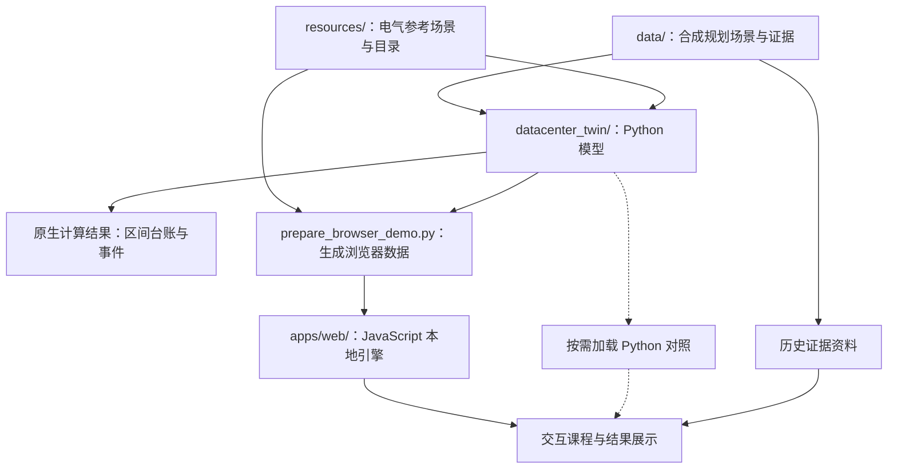
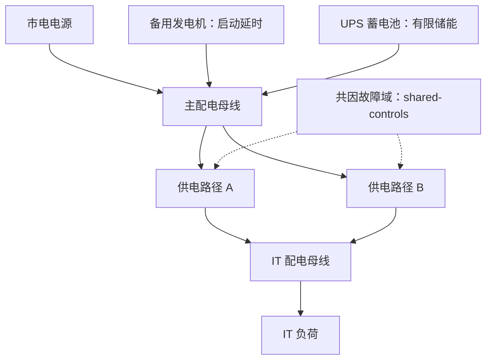

[English](./README.md) | **简体中文**

# Datacenter Twin Lab｜数据中心数字孪生实验室

**一次停电，一本能量收支台账，一套可复现的供电连续性实验。**

从市电中断到蓄电池耗尽，从冗余供电路径到共因故障域，用可检查的输入、计算和结果理解数据中心供配电系统。面向工程师、科研人员及学生，所有示例均为合成教学场景。

**[打开在线实验室](https://khanlab.co.technology/) · [学习 24 节课程](https://khanlab.co.technology/learn/) · [查看典型算例](./docs/canonical-case.md)**



## 01｜这个项目能做什么

- 使用确定性的 Python 供电连续性引擎，分析市电中断、备用发电机延时或故障、蓄电池储能量、供电路径容量和共因故障域。
- 使用浏览器内的 JavaScript 引擎开展实验，按需加载 Python（Pyodide）进行对照验证。
- 探索 18 个合成场景预设、4 个示例设施配置及 24 节课程（12 节供电连续性、12 节基础设施工程）。
- 使用报告、参数敏感性分析、独立的电磁暂态（EMT）课程及 5 项电力系统动态研究，了解不同模型的适用边界。

另有[四模块离线教学页面](./docs/index.html)，并非完整的 24 节课程。功能及入口以[英文 README](./README.md)和[文档索引](./docs/INDEX.md)为准。本页面为简体中文项目导览；不代表浏览器界面、CLI 或课程已经完成中文化。

## 02｜从输入到能量收支台账



这是软件数据流示意图，不是实时设施遥测，也不是共享云端仿真服务。浏览器默认使用独立的 JavaScript 实现；虚线表示可选 Python 对照。规划场景（schema 1）与供电连续性场景（schema 2）使用不同的模型契约，不可混用。

依据：[架构参考](./docs/developer/ARCHITECTURE.md)、[浏览器构建说明](./docs/engineering/browser-demo.md)、[数据准备脚本](https://github.com/mohammadrezwankhan/datacenter-twin-lab/blob/72e34163544fd3282f7af95edbbed7a05667c105/scripts/prepare_browser_demo.py#L316-L338)。

## 03｜供电路径与故障边界



本图对应[参考电气场景](https://github.com/mohammadrezwankhan/datacenter-twin-lab/blob/72e34163544fd3282f7af95edbbed7a05667c105/datacenter_twin/resources/reference-site-v2.json#L20-L39)的供电边，省略充电边。模型依次调度市电、已就绪的备用发电机及可用蓄电池。共因故障域可同时使 A、B 路径不可用。两条路径不意味着独立的 2N 系统，也不构成 Tier 等级或可用性证明。详见[供电连续性模型](./docs/engineering/electrical-continuity.md)。

## 04｜五分钟典型算例：100 kWh 能支撑多久？

设 IT 需求功率为 1,000 kW（1 MW），初始蓄电池储能量为 100 kWh，放电效率为 0.90，配电效率为 0.95。市电在仿真开始后 300 s 中断；备用发电机故障，充电禁用。

- IT 侧可交付电量：100 kWh × 0.90 × 0.95 = 85.5 kWh。
- 蓄电池支撑时长：85.5 kWh ÷ 1,000 kW × 3,600 s/h = 307.8 s。
- 蓄电池耗尽时刻：300 s + 307.8 s = 607.8 s。

| 初始储能量 | IT 侧可交付电量 | 支撑时长 | 耗尽时刻 |
| ---: | ---: | ---: | ---: |
| 100 kWh | 85.5 kWh | 307.8 s | 607.8 s |
| 50 kWh | 42.75 kWh | 153.9 s | 453.9 s |

支撑时长从市电中断时刻起算，耗尽时刻从仿真开始起算。能量收支台账同时核对 IT 需求电量、已供电量、未供电量及转换损耗。以上是[典型算例](./docs/canonical-case.md)中的确定性教学结果，不是现场测量数据。

## 05｜安装与运行

### Python 核心

需要 Python 3.12 或更高版本。核心不声明第三方运行时依赖。请在独立 Python 环境中安装。

```bash
pip install datacenter-twin
```

命令来源：[README.md:77](https://github.com/mohammadrezwankhan/datacenter-twin-lab/blob/72e34163544fd3282f7af95edbbed7a05667c105/README.md#L77)。

在已获取的源码仓库根目录中，可运行以下命令：

```bash
python -m pip install .
python -m datacenter_twin simulate --preset generator_failure
python -m unittest discover -s tests -v
```

命令来源：[README.md:85–87](https://github.com/mohammadrezwankhan/datacenter-twin-lab/blob/72e34163544fd3282f7af95edbbed7a05667c105/README.md#L85-L87)。完整测试需要按[贡献指南](./CONTRIBUTING.md)准备依赖和环境。CLI 的 `generator_failure` 预设允许事前充电，与禁用充电的课程算例并非同一输入身份；不要将其输入哈希或运行 ID 视为相同。

### Web 开发

先按[贡献指南](./CONTRIBUTING.md)设置隔离 Python 环境、锁定依赖及 `TWIN_PYTHON`。以下为 macOS／Linux 源码构建步骤中的前端命令，从仓库根目录运行：

```bash
npm --prefix apps/web ci --ignore-scripts
npm --prefix apps/web run build
```

命令来源：[CONTRIBUTING.md:44–45](https://github.com/mohammadrezwankhan/datacenter-twin-lab/blob/72e34163544fd3282f7af95edbbed7a05667c105/CONTRIBUTING.md#L44-L45)。Windows、完整浏览器验证、Pyodide 运行时和测试数据准备见[快速入门](./docs/quickstart.md)与[浏览器开发说明](./docs/engineering/browser-demo.md)。

<details>
<summary>中国大陆开发者：可选软件包镜像</summary>

如官方软件包索引访问不畅，可在个人开发环境中按镜像站官方帮助临时配置 HTTPS 源：

- PyPI：清华 TUNA 镜像，索引地址 `https://mirrors.tuna.tsinghua.edu.cn/pypi/web/simple`，[配置帮助](https://mirrors.tuna.tsinghua.edu.cn/help/pypi/)。
- npm：npmmirror，仓库地址 `https://registry.npmmirror.com`，[配置帮助](https://npmmirror.com/)。

仅在组织允许且可核验依赖来源时使用。镜像可能延迟同步或缺少版本；不可修改锁文件、放宽完整性校验、关闭 TLS 验证或绕过 CI 安全策略。GitHub 发布文件、Playwright 浏览器及运行时下载可能仍需各自的官方网络入口。镜像可达性与本项目锁定依赖的完整供应尚未在中国大陆实测。

</details>

## 06｜工程术语速查

| English | 简体中文 |
| --- | --- |
| Electrical continuity | 供电连续性 |
| Utility feed / utility loss | 市电电源／市电中断 |
| Standby generator | 备用发电机 |
| Uninterruptible power system (UPS) | 不间断电源系统（UPS） |
| Stored battery energy | 蓄电池储能量 |
| Battery ride-through duration | 蓄电池支撑时长 |
| Distribution efficiency | 配电效率 |
| Gross path capacity | 供电路径额定容量 |
| Redundancy | 冗余 |
| Shared failure domain | 共因故障域 |
| Energy ledger | 能量收支台账 |
| Requested / served / unserved IT energy | IT 需求电量／已供电量／未供电量 |
| Battery depletion elapsed time | 蓄电池耗尽时刻 |
| Power usage effectiveness (PUE) | 电能利用效率（PUE） |
| Electromagnetic transients (EMT) | 电磁暂态（EMT） |

完整定义、标准参考及编辑约定见[中英双语工程术语表](./docs/i18n/GLOSSARY.zh-CN.md)。保留 kW、MW、kWh、MWh、kV、PUE 等单位与缩写；代码标识符和机器可读数据不翻译。

## 07｜验证证据与使用限制

- [模型假设与限制](./docs/math-and-physics/ASSUMPTIONS_AND_LIMITS.md)
- [证据资料与复现方法](./docs/evidence.md)
- [发布范围及验证要求](./docs/engineering/release-readiness.md)
- [GitHub Actions](https://github.com/mohammadrezwankhan/datacenter-twin-lab/actions)

本项目用于合成教学及研究，不是现场校准的数字孪生、生产级控制系统、设备选型工具或认证依据。规划 PUE 为假设值，不是实测指标。供电连续性模型不包含交流潮流、保护配合、开关暂态或可靠性概率；独立 EMT 与动态研究亦有各自的边界。外部独立科学复现仍待完成，Engineering HOLD 保持不变。不宣称符合 IEEE、ASHRAE 或 GB 50174 的设计、运行及安全要求。

## 08｜参与贡献与引用

欢迎提交可复现的场景、中文术语改进及翻译建议。请说明源版本、输入、单位、预期结果、实际结果和已知限制。

[贡献指南](./CONTRIBUTING.md) · [问题反馈](https://github.com/mohammadrezwankhan/datacenter-twin-lab/issues) · [变更记录](./CHANGELOG.md) · [引用信息](./CITATION.cff) · [许可证 Apache-2.0](./LICENSE) · [第三方声明](./NOTICE)

[多语言实施审计及路线图](./docs/i18n/AUDIT.md)

译文依据：[源代码基线](https://github.com/mohammadrezwankhan/datacenter-twin-lab/commit/72e34163544fd3282f7af95edbbed7a05667c105)。本导览不替代英文技术契约、历史证据或正式发布记录。
